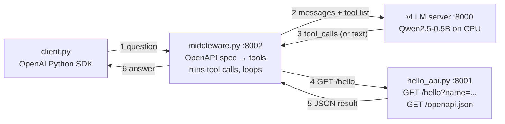

# vLLM Tool-Calling Demo

A small language model (Qwen2.5-0.5B-Instruct) running locally **on the CPU** with [vLLM](https://github.com/vllm-project/vllm), calling a hello-world web service as a tool. Everything is plain Python and runs on your own machine, with no cloud service involved.

It shows the three building blocks behind most AI assistants:

- a **model server** (vLLM),
- a **tool** the model can use (a web API described with OpenAPI),
- a piece of glue code, the **middleware**, that connects the two.

```text
User:  Please say hello to Ada
Tool:  LLM called hello_world({'name': 'Ada'}) -> {"message":"Hello, Ada! 👋 (from hello_api)"}
LLM:   Hello, Ada! 😊 (from hello_api)
```

## Key concepts

| Term | What it means here |
| --- | --- |
| LLM (large language model) | A program that predicts the next word of a text. Here: Qwen2.5-0.5B-Instruct, 0.5 billion parameters, about 1 GB. |
| vLLM | Open-source software that loads an LLM and serves it over HTTP. Built for GPUs, but has a CPU mode, which this demo uses. |
| OpenAI-compatible API | vLLM speaks the same HTTP format as OpenAI's API, so any OpenAI client library works by changing the base URL. |
| Chat completions | The request format: send a list of messages (`user`, `assistant`, `tool`), get back the next assistant message. Endpoint: `POST /v1/chat/completions`. |
| Tool calling | You describe functions in the request. Instead of answering in text, the model may reply "please call function X with these arguments". Your code runs it and sends the result back. |
| OpenAPI | A machine-readable description of a web API. FastAPI generates it automatically at `/openapi.json`. |
| Middleware | Code between client and model. Here it turns the OpenAPI description into tools, runs tool calls, and hides that loop from the client. |

The model never runs code or calls the network itself. It only *asks* for a call; the middleware decides to execute it.

## Architecture

Four small programs talk to each other over HTTP on `127.0.0.1`. Only the middleware talks to all the others.



Steps 2 to 5 can repeat: after the tool result comes back, the middleware asks vLLM again, and this time vLLM replies with text. The client never sees the tool call happen; it gets the final answer plus a short trace (`x_tool_trace`) of which tools ran.

`docs_portal.py` (port 8003) is optional: one Swagger UI page for the OpenAPI specs of all three services.

## Project files

| File | Role | Port |
| --- | --- | --- |
| `setup.sh` | Creates a Python 3.12 virtual environment and installs vLLM's CPU build. | |
| `serve.sh` | Starts the vLLM model server with the right libraries and flags. Optional first argument: another Hugging Face model. | 8000 |
| `hello_api.py` | The tool: FastAPI app with `GET /hello?name=...`. Its `operation_id="hello_world"` becomes the tool name. | 8001 |
| `middleware.py` | Reads `/openapi.json` from the tool, turns each endpoint into a tool, forwards chat requests to vLLM, and runs tool calls. | 8002 |
| `client.py` | Command-line chat client using the official `openai` library, pointed at the middleware. | |
| `docs_portal.py` | Swagger UI with a dropdown for all three APIs, including a proxy so "Try it out" works. | 8003 |

Model weights are downloaded by vLLM on first start into `~/.cache/huggingface/`.

## Requirements

- Linux on x86_64 with AVX2 or AVX-512 (`lscpu | grep -o 'avx2\|avx512f'`)
- About 4 GB free RAM and 5 GB disk (mostly PyTorch)
- [uv](https://docs.astral.sh/uv/)
- Internet access for the first install and model download (and for the Swagger UI assets)

Tested on an AMD Ryzen 7 3800X (Zen 2, AVX2 only), 30 GB RAM, Ubuntu 26.04, vLLM 0.34.0, PyTorch 2.14 (CPU). The machine's AMD RX 5700-class GPU (gfx1010) is not supported by vLLM, which is why this demo runs on CPU.

## Install

```bash
git clone https://github.com/andi1984/vllm-demo.git
cd vllm-demo
./setup.sh
```

## How to start

Open four terminals in the project folder and start one service in each, in this order. The middleware reads the tool's description when it starts, and the client needs everything else running.

1. **Model server.** Wait for `Application startup complete` (about 25 seconds; the first run also downloads the model, about 1 GB).

    ```bash
    ./serve.sh
    ```

2. **Hello-world tool.**

    ```bash
    .venv/bin/uvicorn hello_api:app --port 8001
    ```

3. **Middleware.** It should log `Loaded 1 tool(s) from OpenAPI: ['hello_world']`.

    ```bash
    .venv/bin/uvicorn middleware:app --port 8002
    ```

4. **Ask something.**

    ```bash
    .venv/bin/python client.py "Please say hello to Ada"
    ```

Then try a question that needs no tool, for example `.venv/bin/python client.py "What is 2+2?"`. The client prints `(no tool call - model answered directly)`: the model decides on its own when a tool is useful.

**Optional: API docs portal.**

```bash
.venv/bin/uvicorn docs_portal:app --port 8003
```

Open <http://127.0.0.1:8003> and pick a service from the dropdown at the top right.

**Checking each part on its own:**

```bash
curl http://127.0.0.1:8000/v1/models          # model server: lists the loaded model
curl "http://127.0.0.1:8001/hello?name=Test"  # tool: returns the greeting
curl http://127.0.0.1:8001/openapi.json       # tool: its OpenAPI description
```

## How the middleware detects a tool call

The chat-completions response says it directly: `finish_reason` is `"tool_calls"` and the message carries a `tool_calls` list instead of text.

**1. The request sent to vLLM** includes the tool, generated from the OpenAPI description:

```json
{
  "model": "Qwen/Qwen2.5-0.5B-Instruct",
  "messages": [{"role": "user", "content": "Please say hello to Ada"}],
  "tools": [{
    "type": "function",
    "function": {
      "name": "hello_world",
      "description": "Greet a person by name and return a hello-world message.",
      "parameters": {
        "type": "object",
        "properties": {"name": {"type": "string", "description": "Name of the person to greet"}},
        "required": []
      }
    }
  }],
  "tool_choice": "auto"
}
```

**2. vLLM answers with a tool call**, not text. This is the signal the middleware checks for:

```json
{
  "choices": [{
    "finish_reason": "tool_calls",
    "message": {
      "role": "assistant",
      "content": null,
      "tool_calls": [{
        "id": "chatcmpl-tool-8e1d...",
        "type": "function",
        "function": {"name": "hello_world", "arguments": "{\"name\": \"Ada\"}"}
      }]
    }
  }]
}
```

**3. The middleware runs the call** (`GET http://127.0.0.1:8001/hello?name=Ada`) and appends the assistant's tool call plus the result with the same id:

```json
{"role": "tool", "tool_call_id": "chatcmpl-tool-8e1d...", "content": "{\"message\":\"Hello, Ada! ...\"}"}
```

**4. It asks vLLM again** with the longer conversation. Now `finish_reason` is `"stop"` and the message holds the final text, which goes back to the client. The loop stops after at most 5 rounds.

### What the model actually sees

vLLM turns `messages` + `tools` into one prompt using the model's chat template. For Qwen2.5 that looks like this:

```text
<|im_start|>system
You are Qwen, created by Alibaba Cloud. You are a helpful assistant.

# Tools
...
<tools>
{"type": "function", "function": {"name": "hello_world", ...}}
</tools>

For each function call, return a json object with function name and arguments within <tool_call></tool_call> XML tags
<|im_end|>
<|im_start|>user
Please say hello to Ada<|im_end|>
<|im_start|>assistant
```

The model continues with `<tool_call>{"name": "hello_world", "arguments": {"name": "Ada"}}</tool_call>`. The vLLM flag `--tool-call-parser hermes` turns that text into the structured `tool_calls` field, and `--enable-auto-tool-choice` lets the model choose tools on its own.

### Where the "proxy" lives

There is no proxy library. The middleware offers **the same endpoint as vLLM** and calls vLLM internally:

- `middleware.py`: `@app.post("/v1/chat/completions")` accepts the client's request.
- Inside it, `client.post(f"{VLLM_URL}/v1/chat/completions", ...)` forwards it to vLLM, with tools added.
- `client.py`: `OpenAI(base_url="http://127.0.0.1:8002/v1")` points the client at the middleware instead of vLLM (`:8000`).

## Why these vLLM settings

- **Tiny model.** 0.5B parameters answers a short request in about 5 seconds on 8 CPU cores. 3B+ models are much slower.
- **`--enforce-eager`.** By default vLLM compiles optimised CPU code at startup; on the test machine that took more than 8 minutes. Eager mode skips it.
- **`--max-model-len 4096`.** Limits each conversation to 4,096 tokens to save memory.
- **`VLLM_CPU_KVCACHE_SPACE=2`.** Reserves 2 GB for the KV cache (the model's working memory). Override it before `./serve.sh`.

## Stopping and troubleshooting

Press `Ctrl+C` in each server terminal. vLLM starts helper processes; to make sure none are left over:

```bash
pgrep -af 'vllm|EngineCore|uvicorn'                              # anything listed is still running
pkill -f 'uvicorn (hello_api|middleware|docs_portal)'; pkill -f 'bin/vllm'
ss -ltn | grep -E ':800[0-3]'                                    # no output = ports are free
```

| Symptom | Likely cause | Fix |
| --- | --- | --- |
| `serve.sh` hangs for minutes after "KV cache" lines | Startup compilation is running | Make sure `--enforce-eager` is in `serve.sh` |
| `address already in use` | An old copy is still running | Run the stop commands above |
| Middleware fails to start with a connection error | `hello_api` (port 8001) not running yet | Start `hello_api` first |
| Client prints "no tool call" for a greeting | The 0.5B model sometimes misses the tool | Word it more directly: "Use the hello_world tool to greet Ada" |
| Out of memory or very slow | Too little free RAM | Close other programs or lower `VLLM_CPU_KVCACHE_SPACE` |

## Limitations

- No streaming responses through the middleware.
- Only query and path parameters from the OpenAPI spec are mapped to tool arguments, not request bodies.
- In production, the tool loop usually lives in the application or an agent SDK, and tools are commonly exposed via [MCP](https://modelcontextprotocol.io/). This demo puts everything in one transparent proxy to make each step visible.

## License

[MIT](LICENSE)
